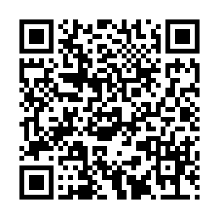

# pix-qrcode-go

[](https://github.com/victorcondackdev/pix-qrcode-go/actions/workflows/ci.yml)
[](https://pkg.go.dev/github.com/victorcondackdev/pix-qrcode-go)

A QR Code encoder (ISO/IEC 18004:2015) written from scratch on the Go
standard library, tuned for Pix BR Codes but general purpose. It picks the
optimal mix of numeric, alphanumeric and byte segments for every input,
which makes typical Pix codes one to three versions smaller than the
byte-mode output of most encoders, and it verifies itself: every symbol in
the test suite is read back by an independent decoder.

<p align="center"></p>

## Why

- **Zero dependencies.** Standard library only, Go 1.22+. `go.mod` has no
  `require` block and CI keeps it that way.
- **Optimal segmentation, measured.** A BR Code is mostly digits and
  uppercase text with a few lowercase runs (`br.gov.bcb.pix`, keys, names).
  A dynamic program over mode switches finds the shortest bit stream; on
  real-shaped payloads that is 20-34% fewer data bits than byte mode and a
  symbol with 14-43% fewer modules (table below). Fewer modules at the same
  print size means bigger modules and faster, more reliable scans.
- **Self-verifying.** `internal/decode` is a strict decoder written
  separately from the encoder: function patterns, BCH-protected format and
  version information, Reed–Solomon syndromes of every block, segment
  syntax, terminator and pad codewords. Round-trip tests cover all 40
  versions × 4 levels, all 8 masks and every mode.
- **Fuzzed.** `FuzzEncode` round-trips arbitrary input and options through
  the decoder; `FuzzDecode` feeds it damaged symbols.
- **Pix-aware but not Pix-bound.** `pixqr` validates the BR Code envelope
  (`000201` prefix, CRC-16/CCITT-FALSE) and defaults to level M; `qr` and
  `render` work for any content.

## Install

```sh
go get github.com/victorcondackdev/pix-qrcode-go
```

CLI:

```sh
go install github.com/victorcondackdev/pix-qrcode-go/cmd/pixqr@latest
```

## Quick start

From a BR Code to an image:

```go
payload := "00020126330014br.gov.bcb.pix0111123456789095204000053039865406150.005802BR" +
	"5912LOJA EXEMPLO6009SAO PAULO62140510PEDIDO123463047DEC"

png, err := pixqr.PNG(payload, 512) // exactly 512x512, integer module size
if err != nil {
	return err // pixqr.ErrNotBRCode, pixqr.ErrCRC or qr.ErrTooLong
}
svg, err := pixqr.SVG(payload, pixqr.WithLevel(qr.Q))
```

What was encoded and what segmentation saved:

```go
d, _ := pixqr.Info(payload)
fmt.Printf("version %d (%dx%d), level %s\n", d.Version, d.Size, d.Size, d.Level)
fmt.Printf("%d bits instead of %d in byte mode (version %d)\n", d.DataBits, d.ByteModeBits, d.ByteModeVersion)
for _, s := range d.Segments {
	fmt.Printf("%-12s %q\n", s.Mode, s.Data)
}
// version 5 (37x37), level M
// 688 bits instead of 1044 in byte mode (version 8)
// numeric      "00020126330014"
// byte         "br.gov.bcb.pix"
// numeric      "0111123456789095204000053039865406150"
// alphanumeric ".005802BR5912LOJA EXEMPLO6009SAO PAULO62140510PEDIDO123463047DEC"
```

The lower-level packages, for any content:

```go
c, err := qr.Encode("https://example.com/", qr.L, qr.WithBoostECL())
if err != nil {
	return err
}
fmt.Println(c.Version, c.Level, c.Size) // 2 Q 25: boosted from L at no size cost
fmt.Println(c.At(0, 0), c.At(-1, 0))    // true false: finder corner, quiet zone

render.PNG(w, c, render.WithModuleSize(10))
render.SVG(w, c, render.WithForeground(color.RGBA{0x32, 0xBC, 0xAD, 0xFF}))
render.Terminal(os.Stdout, c, render.WithInvert())
uri, _ := render.PNGDataURI(c) // data:image/png;base64,...
```

Both snippets mirror the `Example` tests in [`pixqr`](pixqr/example_test.go)
and [`qr`](qr/example_test.go), whose output is checked by `go test`.

## Packages

| Package | Purpose |
| --- | --- |
| [`qr`](https://pkg.go.dev/github.com/victorcondackdev/pix-qrcode-go/qr) | Encoder: segmentation, versions 1-40, levels L/M/Q/H, Reed–Solomon, masking, `CheckClearArea` |
| [`render`](https://pkg.go.dev/github.com/victorcondackdev/pix-qrcode-go/render) | PNG (1-bit), SVG (single merged `<path>`), terminal half blocks, data URIs, logo area |
| [`pixqr`](https://pkg.go.dev/github.com/victorcondackdev/pix-qrcode-go/pixqr) | BR Code validation, `PNG`, `SVG`, `Info` |
| [`cmd/pixqr`](cmd/pixqr) | Command-line interface |
| [`examples/server`](examples/server) | HTTP handler: `GET /qr.svg?payload=...` with ETag and immutable caching |

## Segmentation savings

Five payloads with fictitious keys, names and URLs, all with valid CRCs
(they are the fixtures of [`pixqr/pixqr_test.go`](pixqr/pixqr_test.go),
which asserts every number below). Level M, data bits including mode and
count headers.

| Payload | Bytes | Byte mode | Optimal | Bits saved | Modules saved |
| --- | ---: | --- | --- | ---: | ---: |
| static, random key (EVP), mixed-case name | 137 | 1108 bits, v8 (49×49) | 865 bits, v7 (45×45) | 21.9% | 15.7% |
| static, phone key, amount and txid | 133 | 1076 bits, v8 (49×49) | 814 bits, v6 (41×41) | 24.3% | 30.0% |
| static, CPF key, uppercase name and city | 129 | 1044 bits, v8 (49×49) | 688 bits, v5 (37×37) | 34.1% | 43.0% |
| dynamic, location URL | 166 | 1340 bits, v9 (53×53) | 1065 bits, v8 (49×49) | 20.5% | 14.5% |
| static, e-mail key, 25-character txid | 168 | 1356 bits, v9 (53×53) | 1000 bits, v8 (49×49) | 26.3% | 14.5% |

The win is largest when the merchant name, city and txid are uppercase
(many PSPs already emit them that way). A random EVP key or a URL is
lowercase, so it stays in byte mode; the digits around it still do not.

## CLI

```text
$ pixqr -h
pixqr renders a Pix BR Code as a QR Code.

Usage:
  pixqr [flags] [payload | -]

The payload is read from standard input when it is omitted or "-";
surrounding whitespace is ignored. Without -o, the code is printed to
the terminal (or, with --svg, the SVG document is written to standard
output).

Flags:
  -o FILE        write the image to FILE (PNG, or SVG with --svg or a .svg name)
  --svg          produce SVG instead of PNG
  --term         print the code to the terminal (also with -o)
  --invert       for --term: draw light modules filled (dark terminals)
  --level L      error correction level L, M, Q or H (default M)
  --size PX      PNG width and height in pixels (default 512)
  --quiet N      quiet zone in modules (default 4)
  --info         print version, size, segments and savings vs byte mode
  --no-validate  encode the input even if it is not a valid BR Code

Exit status: 0 success, 1 invalid input, 2 usage error.
```

```text
$ pixqr --info -o pix.png '00020126330014br.gov.bcb.pix0111123456789095204000053039865406150.005802BR5912LOJA EXEMPLO6009SAO PAULO62140510PEDIDO123463047DEC'
version   5 (37x37 modules)
level     M
mask      0
payload   129 bytes
data      688 bits (byte mode: 1044 bits, version 8)
segment   numeric       14  00020126330014
segment   byte          14  br.gov.bcb.pix
segment   numeric       37  0111123456789095204000053039865406150
segment   alphanumeric  64  .005802BR5912LOJA EXEMPLO6009SAO PAULO62140510PEDIDO123463047DEC

$ brpay pix static --key fulano@example.com --name "FULANO DE TAL" --city RECIFE | pixqr --invert
```

The last line pipes a payload built by [brpay](https://github.com/victorcondackdev/brpay)
and prints a scannable code in a dark terminal.

## Design notes

**GF(256) and Reed–Solomon.** Arithmetic uses log/antilog tables for the
field polynomial x⁸+x⁴+x³+x²+1 (0x11D) with α = 2; the antilog table is
doubled so a product is one lookup with no modulo. Generator polynomials
∏(x − αⁱ) are built at start-up for the 13 degrees the block table uses,
and EC codewords are the remainder of an LFSR-style division. The only
tables taken from the standard are the per-version EC codeword and block
counts (Table 9); totals, short/long block sizes and data capacities are
derived from the symbol geometry, and tests pin them against Tables 1 and
7 of the standard.

**Optimal segmentation.** The cost of the next character depends only on
the current mode and, for numeric and alphanumeric, on how many characters
the open group holds: a digit costs 4 bits when it opens a group of three
and 3 bits otherwise (4, 7, 10); an alphanumeric character costs 6 bits
when odd and 5 when even (6, 11); a byte costs 8. A six-state shortest path
(numeric mod 3, alphanumeric mod 2, byte) with a header charge on every
mode switch therefore yields the exact minimum, not the usual rounded
estimate. It runs once per version range (count indicator widths change at
versions 10 and 27), in about 7 µs for a Pix payload, and an exhaustive
search over all mode assignments confirms it on random inputs in the tests.

**Masking.** All eight masks are applied to a byte copy of the matrix, the
matching format information is written in, and the four rules of section
7.8.3 are scored: runs of five or more (3 + extra), 2×2 blocks (3),
1:1:3:1:1 finder look-alikes next to four light modules (40 per side, the
quiet zone counting as light) and dark-module balance (10 per 5% step).
The inner loops are table-driven and branch-free on module data; mask
patterns come from a 12×6 tile that covers every symbol size.

**Logo area.** `render.WithLogoArea` blanks a centred square in the SVG
for a logo overlay. It is refused below level Q and whenever
`qr.Code.CheckClearArea` objects: the square must not touch finder,
timing, format or version modules, and in every Reed–Solomon block it may
hide at most a quarter of the EC codewords, half of what the block can
correct, leaving the rest for print and scan defects. A reader cannot
tell hidden modules from damaged ones, so the logo spends error correction
that real-world conditions would otherwise use; keep it small, prefer H
and test with the devices your customers carry.

## Verification

The encoder cannot lean on a reference implementation from the module
proxy, so correctness is established from several independent directions:

1. **Published vectors.** The data and EC codewords of the `01234567` 1-M
   example from ISO/IEC 18004 Annex I and of the widely reproduced
   `HELLO WORLD` 1-M example; the degree-7 generator polynomial; format
   words for L/0 and M/0; the version 7 information word.
2. **Spec tables.** Total codewords for all 40 versions (Table 1),
   character capacities at both ends of the version range for every level
   and mode (Table 7: the maximum fits, one more character fails),
   remainder bits, and alignment centres computed by formula against the
   Annex E table.
3. **Structural invariants.** Every format word for all 32 level/mask
   pairs and every version word for 7-40 recomputed by polynomial
   division in the decoder; minimum Hamming distances of 7 and 8; free
   modules in the drawn matrix equal to the geometric formula.
4. **Independent decoder.** Round trips at all versions × levels with
   inputs filling the symbol, all masks, all modes, UTF-8, and under
   fuzzing; the decoder rejects any symbol whose syndromes, padding or
   function patterns are off.
5. **External decoder.** [`scripts/opencv_crosscheck.py`](scripts/opencv_crosscheck.py)
   decodes a corpus written by `render` (one near-full mixed-mode symbol
   per version and level, the Pix sample at all eight masks, logo-area
   symbols at Q and H, UTF-8) with OpenCV. All 171 images decode to the
   exact input.

## Benchmarks

Go 1.24, linux/amd64, Intel Xeon @ 2.10 GHz (2 vCPU). The Pix payload is
153 bytes (EVP key, amount, txid), which encodes to version 7-M.

```text
BenchmarkEncodePix              ~195 µs/op   18.6 KB/op   19 allocs/op
BenchmarkEncodePixByteMode      ~260 µs/op   20.4 KB/op   14 allocs/op   (version 8)
BenchmarkEncodePixFixedMask      ~37 µs/op   10.4 KB/op   15 allocs/op
BenchmarkEncodeVersion40        ~3.1 ms/op    439 KB/op   22 allocs/op
BenchmarkSegmentation           ~7.4 µs/op    4.6 KB/op    6 allocs/op
BenchmarkPNG (512×512)          ~0.5 ms/op    1.5 KB/op   13 allocs/op   (1.0 KB file)
BenchmarkPNGStdlib (image/png)  ~2.8 ms/op    1.1 MB/op   37 allocs/op
BenchmarkSVG                     ~46 µs/op    7.4 KB/op   15 allocs/op
BenchmarkTerminal                ~13 µs/op    4.2 KB/op    3 allocs/op
```

Mask selection is most of the encoding time (compare the fixed-mask run);
`qr.WithMask` skips it when throughput matters more than the last bit of
scan quality. The PNG writer packs 1-bit rows straight from the modules
and reuses zlib state through a `sync.Pool`, which is why it beats
`image/png` by about 5× with three orders of magnitude less garbage.

```sh
go test -run '^$' -bench . -benchmem ./qr ./render
```

## Scope

Model 2 symbols with numeric, alphanumeric and byte modes. Not
implemented: Kanji mode, ECI headers (byte segments carry UTF-8 as is, the
convention every mainstream reader follows), Structured Append, Micro QR
and rMQR. The decoder in `internal/decode` reads clean module grids only;
it is a verification tool, not a camera scanner.

## Related

- [brpay](https://github.com/victorcondackdev/brpay): decode, lint and
  build the Pix payloads this library draws, plus boletos, CPF/CNPJ and
  EndToEndIds.

## License

[MIT](LICENSE)
